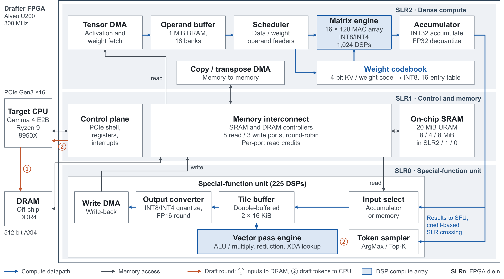
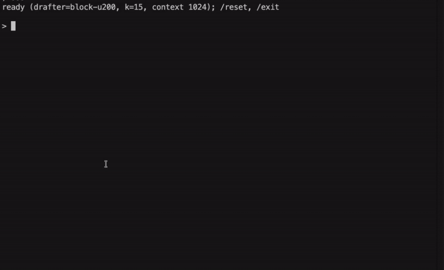

# T-Accelerator — Integrated Tensor Accelerator

**FPGA acceleration for speculative decoding: CPU Target + Alveo U200 Drafter.**

The AMD Ryzen 9 9950X runs the Target model and verifies draft tokens. The U200 runs the drafter.
Current image: **r57**, at **300 MHz**. Data below was measured on **2026-10-29** and **2026-10-30**.

## Architecture

  
   <em>Top-level architecture (<a href="fig/top.pdf">PDF</a>)</em>

| Component | Function |
|---|---|
| TPU | PM16 × TC128 datapath with 1,024 DSP48E2. INT8/SINT4 dense and attention operations. |
| TACC | INT32 accumulation, GPTQ scaling and FP32 FMA. |
| SFUC | Activation functions, Softmax, RMSNorm and ArgMax/TopK. |
| Memory | 20 MiB URAM AXI SRAM, 1 MiB BRAM TUBUF and one DDR4 bank. |
| Control | Two command streams fetched from host memory. Registered credit crossings connect the three SLRs. |

The drafter keeps KV cache and activations on chip. DFlash and cflash use the same compute hardware.

## Physical Implementation

Alveo U200 (`xcu200-fsgd2104-2-e`), Vivado/Vitis 2024.2, r57 routed design.

| Timing at 300 MHz | Result |
|---|---:|
| Setup slack (WNS) | +0.016 ns |
| Hold slack (WHS) | +0.004 ns |
| Failing endpoints | 0 setup / 0 hold |

**Kernel resources, excluding the platform shell:**

| Resource | Used | User budget | Utilization |
|---|---:|---:|---:|
| LUT | 374,537 | 1,004,454 | 37.29% |
| Registers | 419,937 | 2,106,023 | 19.94% |
| BRAM tiles | 696 | 1,900 | 36.63% |
| URAM | 640 | 940 | 68.09% |
| DSP | 1,418 | 6,833 | 20.75% |

LUT usage includes 27,155 LUTs used as memory. Percentages use the capacity remaining after the platform shell.

Sources: [kernel utilization](reports/r57_kernel_util_routed.rpt),
[post-route timing summary](reports/r57_timing_summary_postroute.rpt) (excerpt).

## On-Board Results

  
   <em>Interactive chat demo: Qwen3-4B Q8_0 Target + DFlash z-lab block 16 drafter on the U200 (<code>run_qwen3.sh chat</code>).
  Recorded on the r57 diagnostic image (r57 logic plus passive trace).</em>

Qwen3-4B Q8_0 Target, DFlash z-lab block 16, Ryzen 9 9950X, U200 at 300 MHz.
Each table reports mean decode throughput over two repetitions, each with eight prompts.

**Current deployment (r57, 2026-10-30).** The DFlash configuration uses 13 Target threads.
The remaining three physical cores run Host and runner work. Runner L3 isolation and huge pages are enabled.
Head rescore re-ranks the top two device candidates of each draft row with the Target's own Q8_0 LM head rows.

| Prompt set | Maximum new tokens | Rescore off (tok/s) | Rescore on, deployed (tok/s) | Change |
|---|---:|---:|---:|---:|
| short8 | 96 | 49.03 | 53.12 | +8.33% |
| med8 | 96 | 46.50 | 42.85 | −7.85% |
| short8 | 256 | 47.30 | 49.77 | +5.22% |

Rescore adds 0.17 ms of draft time per round on average.
Most of the med8 loss comes from two code prompts. On these prompts, the Target's Q8_0 head drafts worse than the device head.
All 12 timed runs passed token equality checks. Both oracle runs matched the device output.

**CPU-only comparison (r56, 2026-10-29).** This is the most recent same-day comparison.
The U200 configuration used 12 Target threads, with four physical cores reserved for Host and runner work.
The CPU-only baseline uses the native `llama.cpp` DFlash loop with 16 threads.

| Prompt set | Maximum new tokens | CPU + U200, r56 (tok/s) | CPU-only (tok/s) |
|---|---:|---:|---:|
| short8 | 96 | 47.99 | 48.39 |
| med8 | 96 | 45.06 | 45.42 |
| short8 | 256 | 46.48 | 48.23 |

All 30 runs in the comparison passed token equality checks.
In these conditions, the r56 configuration was 0.8–3.6% below the native CPU-only baseline.
The CPU drafter uses float-initialized Q8_0 weights. The U200 drafter uses QAT/codebook weights.
There is no same-day measurement of r57 against CPU-only yet. Do not compare the two tables directly.

Sources: [r57 rescore runs](reports/board_r57_20261030_rescore.txt),
[r56 CPU-only comparison runs](reports/board_r56_20261029_cpu_vs_u200.txt).

## Reproducibility

- Toolchain: Vivado/Vitis 2024.2, XRT 2.19.194, Ubuntu 24.04.
- Image r57: xclbin SHA-256 prefix `ed62a3b6`, RTL tree SHA-256 prefix `4e6c0de1`.
- The runner checks the image fingerprint before execution.
- The reports in [`reports/`](reports) are excerpts from the private development repository. Host names and log paths are removed.
- This repository does not contain RTL source yet. The planned release uses IEEE 1735 encryption of the core RTL for double-blind review.
- `hw_emu` validates functionality. DDR timing and bandwidth require board measurements.
