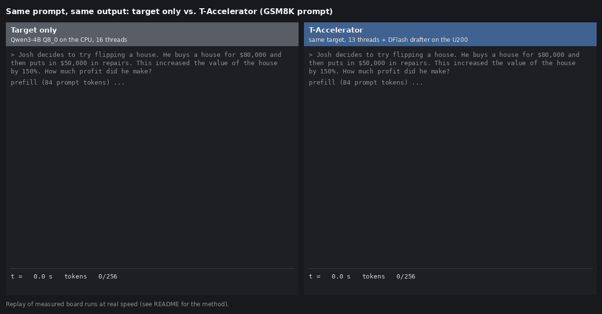
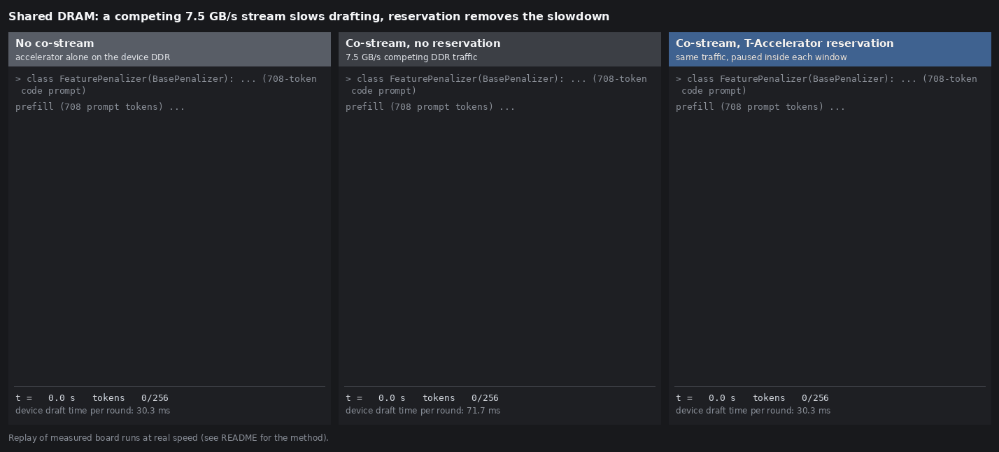
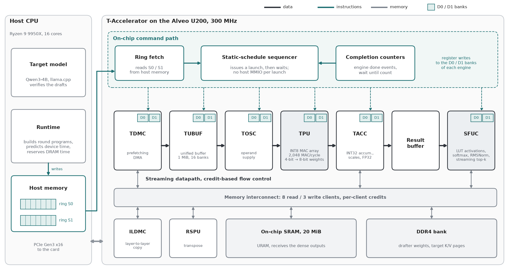
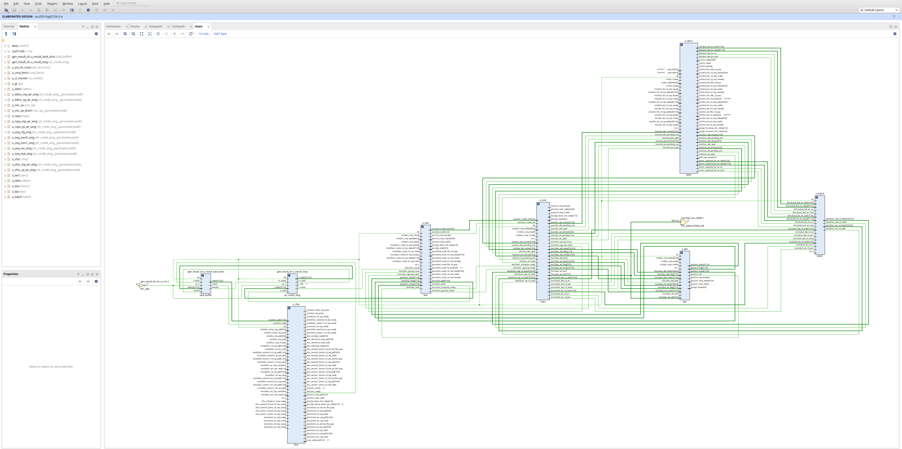
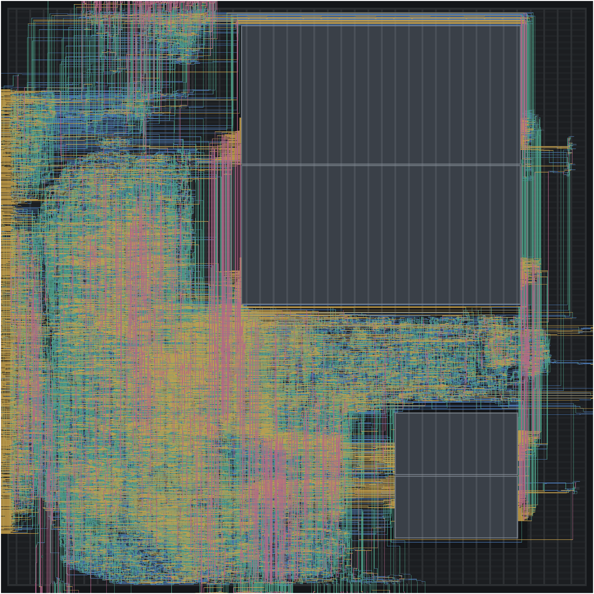

# T-Accelerator

FPGA acceleration for speculative decoding. The target model runs on the CPU, and the drafter runs on an AMD Alveo U200.

## Demos

Qwen3-4B (Q8_0) answers a GSM8K question on 16 CPU threads alone, and again with 13 threads plus the DFlash drafter on the U200.
Both runs emit the same tokens. Over 64 prompts from GSM8K, HumanEval, MT-Bench and Alpaca, decoding goes from 13.86 to 33.46 tokens/s (2.41×).

On this prompt, a competing 7.5 GB/s DDR stream slows drafting from 30.3 to 71.7 ms per round. Reserving DRAM time for each draft request keeps it at 30.3 ms.

Both GIFs replay measured board runs at their original speed. Rounds are spaced evenly over the measured decode time, because the logs do not time-stamp individual rounds.

## Architecture

## Implementation

Alveo U200 (`xcu200-fsgd2104-2-e`), Vivado/Vitis 2024.2, image r62. Timing closes at 300 MHz (WNS +0.002 ns, WHS +0.003 ns).

| LUT | FF | BRAM (36 Kb) | URAM | DSP |
|---:|---:|---:|---:|---:|
| 375,362 | 420,844 | 697 | 640 | 1,418 |

Kernel only, without the platform shell. Per-block numbers are in [`results/`](results).

ASAP7 logic synthesis at 1 GHz (TT, 0.7 V) gives 0.634 mm² of logic and 0.75 W of logic power, not including the SRAM macros.
The picture below is one placed-and-routed block, the command fetch unit (130.7 × 130.7 µm).

The RTL source is not in this repository.
