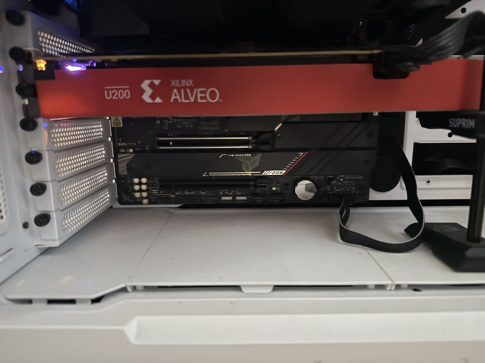
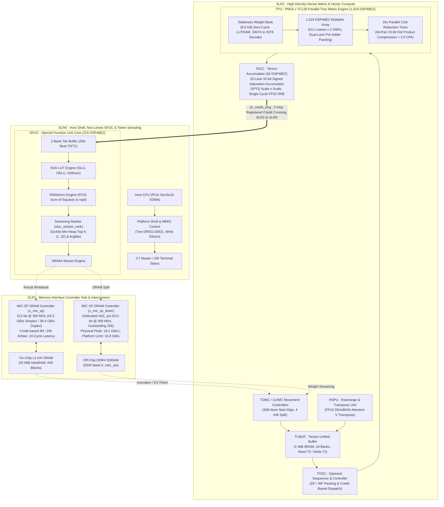
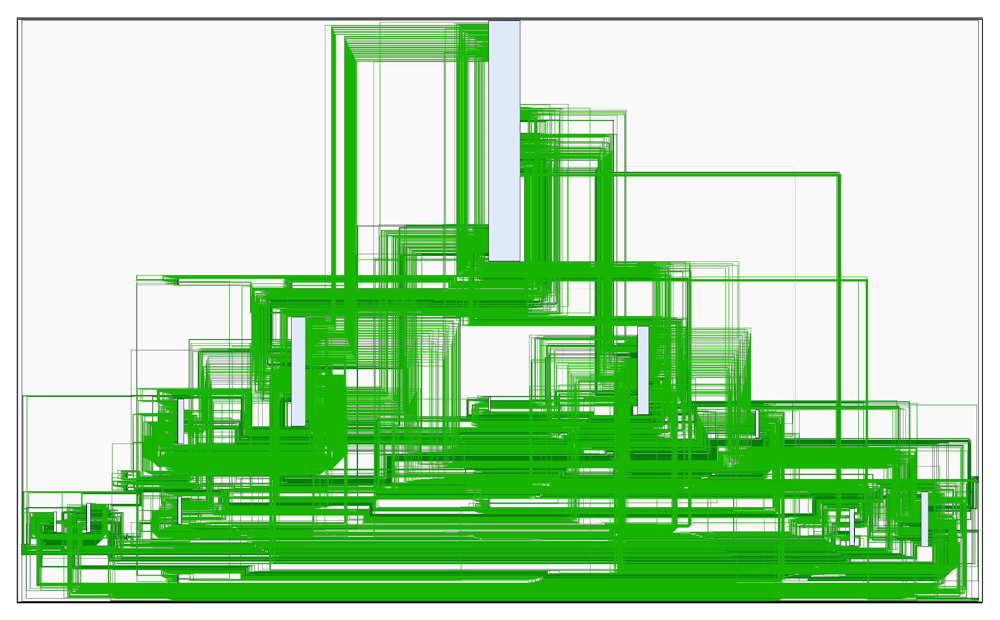
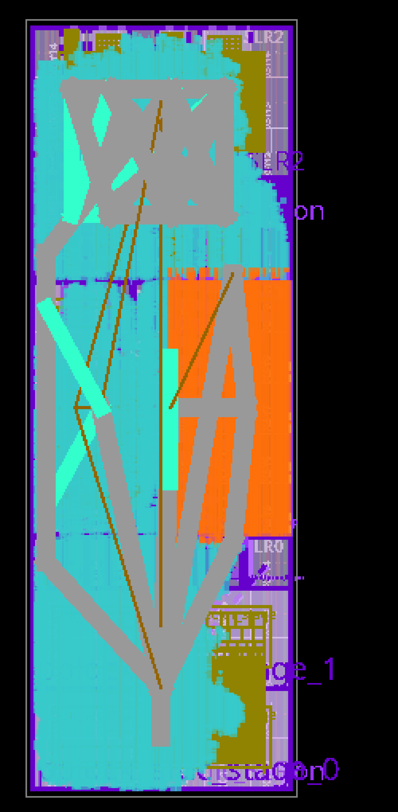
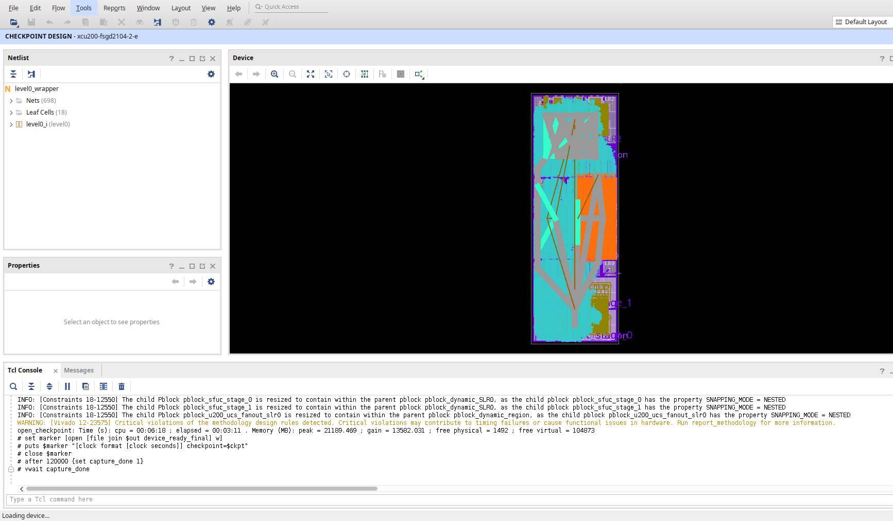
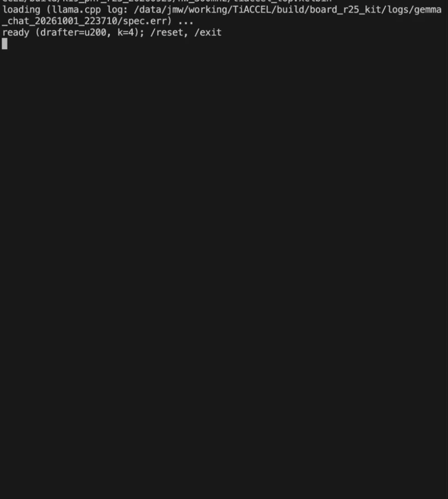

# TiAccel: Transformer Integrated Accelerator

> **Heterogeneous On-Chip Architecture for High-Throughput & Low-Latency LLM Inference**  
> AMD / Xilinx Alveo U200 FPGA (**DATA_CLK 300 MHz Fully Closed** & On-Board Silicon Verified)

---

## 📌 Key Highlights & Performance Summary

| Metric | Specification & Silicon Measurement | Details |
|---|---|---|
| **Target Platform** | **AMD / Xilinx Alveo U200** | `xcu200-fsgd2104-2-e` (Active Cooling) |
| **Heterogeneous Co-Processing** | **Host CPU (Target) + FPGA (Drafter)** | **AMD Ryzen 9 9950X** (Target: Gemma 4 E2B Q8_0) + **Alveo U200** (Drafter: TiAccel MTP) |
| **Speculative Inference Throughput** | **Up to 32.63 tok/s** (**1.77× speedup**) | CPU 9950X Target-Only 18.45 tok/s $\to$ Co-Processing 32.63 tok/s (Acceptance Length $\alpha = 2.50$) |
| **Core Frequency** | **300.00 MHz** (`DATA_CLK`) | Vivado 2024.2 Physical Signoff (**WNS: +0.005 ns, TNS: 0.000 ns, 0 Violations**) |
| **On-Board Token Latency** | **12.52 – 12.67 ms / token** | Measured on U200 hardware (W65 4-step chain, 528 tensors Bit-Exact PASS) |
| **Raw Decode Throughput** | **~80 tokens/s (78.9 – 79.9 tok/s)** | Single-stream decode throughput on silicon |
| **On-Chip L2 SRAM Bandwidth** | **19.2 GB/s (Simplex) / 38.4 GB/s (Duplex)** | 512-bit @ 300 MHz, 1.000 beat/cycle saturation, Read 10-cycle ultra-low latency |
| **Off-Chip DRAM Bandwidth** | **19.2 GB/s (Bus Peak) / 16.8 GB/s (Platform Limit)** | Dedicated m01_axi 512-bit @ 300 MHz (U200 single DDR4 bank limit: 16.8 GB/s) |
| **Compute Core (TPU)** | **1,024 DSP48E2** | PM16 × TC128 Parallel Tree Engine (Stationary LUTRAM Weights, 16× CSA Tree Reducers) |
| **On-Chip L2 Memory** | **20 MiB UltraRAM (640 URAM)** | Distributed AXI SRAM for zero-latency local KV Cache & activation staging |
| **Power Consumption** | **49.26 W** (Dynamic 45.51 W, Static 3.75 W) | Junction Temperature: 50.7 °C (Ample cooling headroom) |

---

## 1. Overview

Large Language Model (LLM) serving consists of two computationally distinct phases:
1. **Prefill Phase**: Processes the entire input prompt in parallel, characterized by **compute-intensive** operations (dominated by GEMM).
2. **Decode Phase**: Generates subsequent tokens autoregressively one by one, characterized by **memory-bound** operations (dominated by GEMV and recurrent KV Cache lookups).

Conventional accelerators optimized for only one phase suffer from substantial memory bottlenecks and severe compute idle time during the decode stage due to continuous off-chip DRAM round-trips for KV Cache access.

**TiAccel (Transformer Integrated Accelerator)** is a heterogeneous neural processing architecture integrated on a single chip to address both bottlenecks simultaneously:

- **High-Density K19 Parallel Tree TPU (1,024 DSPs)**: PM16 × TC128 matrix multiplication engine with zero-cycle stationary LUTRAM weight banks and high-speed CSA reduction trees, accelerating large-scale GEMM/GEMV workloads with maximum compute density.
- **20 MiB Tightly-Coupled On-Chip AXI SRAM (640 UltraRAMs)**: Stages KV Cache and intermediate activations directly on-chip, eliminating high-latency off-chip DRAM round-trips.
- **Shared Unified Datapath**: Both dense matrix multiplications and attention mechanisms share an unbypassed, deterministic streaming datapath. A dedicated Special Function Unit Core (SFUC) accelerates non-linear activations (SiLU/GELU), RMSNorm normalization, and streaming ArgMax/TopK token sampling in a single pass.
- **Heterogeneous Speculative Decoding Co-Processor (CPU 9950X Target + FPGA U200 Drafter)**: Collaboratively pairs the **AMD Ryzen 9 9950X** 16-core Host CPU (running Target model verification for **Gemma 4 E2B** via `llama.cpp` Q8_0) with the **AMD Alveo U200** FPGA accelerator (running the low-latency **Gemma 4 MTP Drafter** on TiAccel hardware). Achieves interactive serving at up to **32.63 tok/s** (**1.77× speedup** over CPU target alone) while guaranteeing 100% bit-exact output equivalence with target greedy generation.

<p align="center">
  
  <br>
  <em>Figure 1. TiAccel Hardware Prototype Platform: AMD Alveo U200 Data Center Accelerator Card</em>
</p>

---

## 2. System Architecture & Subsystems

### 2.1 Unified Datapath Pipeline

TiAccel maintains a deterministic, pipelined datapath from Host MMIO dispatch to final memory retirement:



#### Detailed Hardware Subsystem Interconnect & Register Interface

```text
========================================================================================================================
                                     AMD / Xilinx Alveo U200 Platform (DATA_CLK 300.00 MHz)
========================================================================================================================

 ┌────────────────────────────────────────────────────────────────────────────────────────────────────────────────────┐
 │  SLR0 : Host Shell, Non-Linear Execution Core & Token Sampling                                                      │
 │                                                                                                                    │
 │  ┌──────────────────────────────────────────────┐        ┌──────────────────────────────────────────────────────┐  │
 │  │ PCIe Gen3x16 Shell & Host Control Interface  │        │ SFUC (Special Function Unit Core, 225 DSP48E2)       │  │
 │  │                                              │        │                                                      │  │
 │  │  • XDMA / PCIe Subsystem (MMIO & DMA)        │        │  ┌────────────────────────────────────────────────┐  │  │
 │  │  • Two-Descriptor (D0/D1) Ping-Pong Control │        │  │ Tile Buffer : 2-Bank 256-Beat SRAM (T0 / T1)   │  │  │
 │  │  • Write Elision (Delta-Writing, 3.3x gain)  │        │  └───────────────────────┬────────────────────────┘  │  │
 │  │  • Global Register (GR) 14 Terminal Bits     │        │                          ▼                           │  │
 │  └──────────────────────┬───────────────────────┘        │  ┌────────────────────────────────────────────────┐  │  │
 │                         │ MMIO Command                   │  │ XDA (Exponent-Direct Addressing) LUT Engine    │  │  │
 │                         ▼                                │  │  • SiLU / GELU / Softmax (e^x, sum e^x, 1/sum) │  │  │
 │                 ┌──────────────┐                         │  │  • Piecewise Linear Interpolation (y0 + t*dy)  │  │  │
 │                 │  CT Master   │                         │  └───────────────────────┬────────────────────────┘  │  │
 │                 └──────┬───────┘                         │                          ▼                           │  │
 │                        │                                 │  ┌────────────────────────────────────────────────┐  │  │
 │                        │                                 │  │ RMSNorm Engine : FP32 Sum-of-Squares & rsqrt   │  │  │
 │                        │                                 │  └───────────────────────┬────────────────────────┘  │  │
 │                        │                                 │                          ▼                           │  │
 │                        │                                 │  ┌────────────────────────────────────────────────┐  │  │
 │                        │                                 │  │ Streaming Ranker (sfuc_stream_rank)            │  │  │
 │                        │                                 │  │  • 32x44-bit Hardware Min-Heap                 │  │  │
 │                        │                                 │  │  • Cycle-by-Cycle Streaming Top-K (1..32)      │  │  │
 │                        │                                 │  │  • Single-Pass ArgMax Token Extraction         │  │  │
 │                        │                                 │  └───────────────────────┬────────────────────────┘  │  │
 │                        │                                 │                          ▼                           │  │
 │                        │                                 │  ┌────────────────────────────────────────────────┐  │  │
 │                        │                                 │  │ WDMA Engine : Packed Result Writeback Streams  │  │  │
 │                        │                                 │  └───────────────────────┬────────────────────────┘  │  │
 │                        │                                 └──────────────────────────┼───────────────────────────┘  │
 │                        │                                                            │ WDMA Data Stream             │
 └────────────────────────┼────────────────────────────────────────────────────────────┼──────────────────────────────┘
                          │                                                            │
    ══════════════════════╪════════════════════════════════════════════════════════════╪══════════════ [SLR0 / SLR1 Boundary]
                          │                                                            │
 ┌────────────────────────┼────────────────────────────────────────────────────────────┼──────────────────────────────┐
 │  SLR1 : Central Memory Interface & Multi-Client Arbitration Hub                             │                              │
 │                        ▼                                                            │                              │
 │  ┌──────────────────────────────────────────────────────────────────────────────────┴───────────────────────────┐  │
 │  │ MIC-SP (Memory Interface Controller / Scratchpad)                                                            │  │
 │  │                                                                                                              │  │
 │  │  ┌──────────────────────────────────────────────────┐    ┌────────────────────────────────────────────────┐  │  │
 │  │  │ u_mic_sp (On-Chip SRAM Controller, RAM_TYPE=0)   │    │ u_mic_sp_dram (Off-Chip DRAM Controller)       │  │  │
 │  │  │  • 512-bit AXI4 @ 300 MHz                        │    │  • Dedicated m01_axi Port (512-bit @ 300 MHz)  │  │  │
 │  │  │  • 1.000 Beat/Cycle Saturation (19.200 GB/s)     │    │  • Outstanding 256 Depth Transaction Queue     │  │  │
 │  │  │  • Full-Duplex Saturation (38.400 GB/s Duplex)   │    │  • 4 KiB Boundary Splitting & 32B Atom Align   │  │  │
 │  │  │  • Non-Blocking Pre-Reservation Arbiter          │    │  • Physical Bus Peak: 19.200 GB/s              │  │  │
 │  │  │    (8 Read Clients + 2 Write Clients, Zero HOL)  │    │  • Platform DDR4 Bank Ceiling: 16.8 GB/s       │  │  │
 │  │  │  • 10-Cycle Ultra-Low Read Latency               │    │  • Continuous Model Weight Streaming           │  │  │
 │  │  └────────────────────────┬─────────────────────────┘    └───────────────────────┬────────────────────────┘  │  │
 │  └───────────────────────────┼──────────────────────────────────────────────────────┼───────────────────────────┘  │
 └──────────────────────────────┼──────────────────────────────────────────────────────┼──────────────────────────────┘
                                │                                                      │
                                ▼                                                      ▼
                   ┌──────────────────────────┐                          ┌──────────────────────────┐
                   │  On-Chip L2 AXI SRAM     │                          │  Off-Chip DDR4 SDRAM     │
                   │  (20 MiB UltraRAM, 640U) │                          │  (DDR Bank 0, m01_axi)   │
                   │  • Distributed SLR0/1/2  │                          │  • Model Weights Storage │
                   │  • KV Cache Zero Bubble  │                          │  • Scratch / Context IO  │
                   └────────────┬─────────────┘                          └─────────────┬────────────┘
                                │                                                      │
                                └──────────────────────┬───────────────────────────────┘
                                                       │ Activation / Weight Fetches (32B Atom Aligned)
    ═══════════════════════════════════════════════════╪══════════════════════════════════════════════ [SLR1 / SLR2 Boundary]
                                                       │
 ┌─────────────────────────────────────────────────────┼──────────────────────────────────────────────────────────────┐
 │  SLR2 : High-Density Dense Matrix & Vector Compute Engine                                                          │
 │                                                     ▼                                                              │
 │  ┌──────────────────────────────────────────────────────────────────────────────────────────────────────────────┐  │
 │  │ Data Ingress & Buffering                                                                                     │  │
 │  │                                                                                                              │  │
 │  │  ┌───────────────────────────────────────────────┐     ┌──────────────────────────────────────────────────┐  │  │
 │  │  │ ILDMC / TDMC Movement Controllers             │     │ TUBUF (Tensor Unified Buffer, 1 MiB BRAM)        │  │  │
 │  │  │  • TFMC : Activation Stream Fetcher           │────►│  • 16 Independent Physical Banks (64B / Bank)    │  │  │
 │  │  │  • TWMC : Quantized Weight Stream Fetcher     │     │  • 1,024 Rows x 64B per Bank (Conflict-Free)     │  │  │
 │  │  │  • 32B Atom Start Align & Odd-Atom Tail Mask  │     │  • Read Latency: T5 / Write Latency: T2          │  │  │
 │  │  └───────────────────────────────────────────────┘     └────────────────────────┬─────────────────────────┘  │  │
 │  └─────────────────────────────────────────────────────────────────────────────────┼────────────────────────────┘  │
 │                                                                                    │                               │
 │                                                                                    ▼                               │
 │  ┌──────────────────────────────────────────────────────────────────────────────────────────────────────────────┐  │
 │  │ TOSC (Tensor Operand Sequencer & Controller)                                                                 │  │
 │  │  • Issues 64B Entry Vectors from TUBUF                                                                       │  │
 │  │  • Formats Activation (DF) & Weight (WF) Streams                                                             │  │
 │  │  • Credit-Based Dispatch Flow Control to TPU Engine                                                          │  │
 │  └─────────────────────────────────────────────────┬────────────────────────────────────────────────────────────┘  │
 │                                                    │ Activation DF Stream & Weight WF Stream                       │
 │                                                    ▼                                                               │
 │  ┌──────────────────────────────────────────────────────────────────────────────────────────────────────────────┐  │
 │  │ TPU : PM16 x TC128 Parallel Tree Matrix Engine (1,024 DSP48E2)                                               │  │
 │  │                                                                                                              │  │
 │  │  ┌────────────────────────────────────────────────────────────────────────────────────────────────────────┐  │  │
 │  │  │ Stationary Weight Bank (8.5 KiB Zero-Cycle Distributed LUTRAM)                                          │  │  │
 │  │  │  • Pre-Decoded Operands (wt_decode_int) : On-the-fly SINT4 -> INT8 Expansion (100% Shared Datapath)      │  │  │
 │  │  └────────────────────────────────────────────────┬───────────────────────────────────────────────────────┘  │  │
 │  │                                                   │ Stationary Pre-Decoded Weights                           │  │
 │  │                                                   ▼                                                          │  │
 │  │  ┌────────────────────────────────────────────────────────────────────────────────────────────────────────┐  │  │
 │  │  │ 1,024 DSP48E2 Parallel Multiplier Array (512x tpu_mac_int_mul_pair Leaves)                             │  │  │
 │  │  │  • Geometry: 8 Lane-Pairs x 64 K-Cells (PM16 Output Lanes x TC128 Channel Depth)                       │  │  │
 │  │  │  • Dual-Lane DSP Packing: Lane B packed 18-bit above Lane A in DSP Pre-Adder                           │  │  │
 │  │  │  • Internal Cascade: PCOUT -> PCIN carries pair accumulation without external FPGA LUT fabric          │  │  │
 │  │  └────────────────────────────────────────────────┬───────────────────────────────────────────────────────┘  │  │
 │  │                                                   │ 512 Pair-Products (M2 Stage)                             │  │
 │  │                                                   ▼                                                          │  │
 │  │  ┌────────────────────────────────────────────────────────────────────────────────────────────────────────┐  │  │
 │  │  │ 16x Parallel CSA Reduction Trees (pm16_reducer_int & reduce_lane_int)                                   │  │  │
 │  │  │  • Carry-Save Adder (CSA) Reduction Tree compresses 64 K-Cell products to 23-bit Dot Product           │  │  │
 │  │  │  • C3 Carry-Propagate Adder (CPA) produces signed 32-bit Partial Sum                                   │  │  │
 │  │  │  • Deterministic Fixed Pipeline Latency: Exactly 8 Clock Cycles from M2 to Result Seam                │  │  │
 │  │  └────────────────────────────────────────────────┬───────────────────────────────────────────────────────┘  │  │
 │  └───────────────────────────────────────────────────┼──────────────────────────────────────────────────────────┘  │
 │                                                      │ 16 Lanes x 32-bit Dot Product Stream                        │
 │                                                      ▼                                                             │
 │  ┌──────────────────────────────────────────────────────────────────────────────────────────────────────────────┐  │
 │  │ TACC (Tensor Accumulator, 64 DSP48E2)                                                                        │  │
 │  │  • 16-Lane Parallel 32-bit Signed Saturation Accumulator (accm_int_sum_array)                                 │  │
 │  │  • Inter-Tile Accumulation: Temporal accumulation over sequential K-dimension iterations                     │  │
 │  │  • GPTQ Dequantization: Scale Scaling Engine (Activation Scale x Weight Scale)                               │  │
 │  │  • Converter: Single-Cycle FP32 Round-to-Nearest-Even (RNE) Conversion                                       │  │
 │  └────────────────────────┬─────────────────────────────────────────────────────────────────────────────────────┘  │
 │                           │                                                                                        │
 │                           │ 512-bit FP32 Stream                                     ┌───────────────────────────┐  │
 │                           ▼                                                         │ RSPU (Transpose Unit)     │  │
 │  ┌──────────────────────────────────────────────────────────────────────────┐       │  • FP16 D64xBK64 Transpose│  │
 │  │ slr_credit_xing : 2-Hop Registered Credit Crossing (SLR2 -> SLR1 -> SLR0)│       │  • Attention V Transpose  │  │
 │  └────────────────────────┬─────────────────────────────────────────────────┘       └─────────────┬─────────────┘  │
 └───────────────────────────┼───────────────────────────────────────────────────────────────────────┼────────────────┘
                             │                                                                       │ Transposed V
                             └───────────────────────────────────────────────────────────────────────┘ (to TUBUF)
```

### 2.2 Hardware Subsystem Schematic

Subsystems are interconnected through credit-based flow control and registered skid buffers to eliminate routing congestion across Super Logic Region (SLR) boundaries.

<p align="center">
  
  <br>
  <em>Figure 2. TiAccel Top-Level Architecture & Subsystem Interconnect Schematic</em>
</p>

- **TPU (Tensor Processing Unit Core)**: Parallel tree matrix multiplication engine configured with PM16 $\times$ TC128 geometry, integrating 1,024 DSP48E2 slices. Features an 8.5 KiB zero-cycle distributed LUTRAM stationary weight bank (supporting on-the-fly SINT4-to-INT8 expansion) and 16 parallel Carry-Save Adder (CSA) reduction trees to compute 128-element dot products per lane with deterministic 8-cycle latency.
- **TUBUF (Tensor Unified Buffer)**: 1 MiB on-chip memory organized into 16 independent physical banks (1,024 rows $\times$ 64 B) to guarantee conflict-free parallel tensor feeding (Read latency: T5, Write latency: T2).
- **TOSC (Tensor Operand Sequencer & Controller)**: Sequences TUBUF entries, packages activation (DF) and weight (WF) vectors, and manages credit-based dispatch to the TPU.
- **TACC (Tensor Accumulator)**: 16-lane parallel 32-bit signed saturation accumulator (`accm_int_sum_array`, PM16 $\times$ 32-bit). Accumulates partial sums over sequential K-tiles, applies GPTQ dequantization scaling (activation scale $\times$ weight scale), and performs single-cycle FP32 Round-to-Nearest-Even (RNE).
- **SFUC (Special Function Unit Core)**: Implements 2-bank 256-beat tile storage, hardware XDA (Exponent-Direct Addressing) LUT for high-precision SiLU/GELU/Softmax functions with linear interpolation, RMSNorm normalization, and pipelined streaming TopK/ArgMax sampling with a 32$\times$44-bit Min-heap (225 DSPs).
- **RSPU (Rearrange & Transpose Unit)**: Dedicated hardware for fixed-dimension matrix transposition (FP16 $V$-matrix transpose) in FlashAttention/PagedAttention workloads.
- **On-Chip L2 AXI SRAM**: 640 UltraRAM blocks aggregated into a 20 MiB distributed AXI4 memory subsystem for zero-bubble KV Cache serving.
- **MIC-SP (Memory Interface Controller / Scratchpad)**:
  - **On-Chip SRAM Controller (`u_mic_sp`, `RAM_TYPE=0`)**: 512-bit bus @ 300 MHz achieving **1.000 beat/cycle sustained bus saturation (19.2 GB/s)** with a 10-cycle fixed read latency. Supports credit-based pre-reservation for 8 read and 2 write clients without Head-of-Line (HOL) blocking.
  - **Off-Chip DRAM Controller (`u_mic_sp_dram`, `RAM_TYPE=1`)**: Dedicated to DDR Bank 0 via `m01_axi` (512-bit AXI4 @ 300 MHz, Outstanding 256), delivering a physical AXI bus peak of **19.2 GB/s** and saturating up to the platform DDR4 single-bank ceiling of **16.8 GB/s** for streaming large model weights.

---

## 3. Physical Implementation & Floorplan

TiAccel achieves timing closure at **300.00 MHz** on the AMD Alveo U200 (XCU200) across its 3 Super Logic Regions (SLRs) using `Congestion_SSI_SpreadLogic_high` directives and locality-aware floorplanning.

### 3.1 SLR Partitioning & Floorplan

<p align="center">
  
  <br>
  <em>Figure 3. Locality-Aware Pblock Partitioning across 3 SLRs on AMD Alveo U200</em>
</p>

- **SLR0**: Hosts the non-linear execution core `SFUC` and the PCIe/Platform Shell (BLP).
- **SLR1**: Centers the `MIC-SP` arbitration engines, managing the DDR0 DRAM channel and SRAM crossbars.
- **SLR2**: Consolidates compute-intensive modules—`TPU` (1,024 DSPs), `TACC`, `TUBUF`, `TOSC`, and `TDMC`—to localize high-density routing paths.
- **Distributed Across SLRs**: The 20 MiB UltraRAM L2 SRAM is distributed across all 3 SLRs to prevent routing congestion and balance die utilization.

### 3.2 300 MHz Post-Route Device View

<p align="center">
  
  <br>
  <em>Figure 4. Fully Placed and Routed Device View @ 300 MHz (Build Release: k19_pnr_r21)</em>
</p>

---

## 4. Hardware Implementation & Silicon Metrics

> [!TIP]
> **Complete Physical Signoff Evidence & Vivado Reports Available**:
> All official AMD Vivado™ 2024.2 signoff reports (`.rpt`), including 300.00 MHz post-route timing closure (`WNS +0.005 ns`, 0 violations), 100% route completion status, full chip & kernel utilization, per-SLR Laguna SLL crossing analysis, hierarchical module breakdown (verifying 1,024 DSPs in TPU), power dissipation (49.26 W), and on-board silicon test results are documented in the [`report/`](report/README.md) directory.

### 4.1 Timing Signoff @ 300 MHz

Full timing closure verified at the Vivado 2024.2 `Physopt postRoute` signoff stage across all 1.99 million endpoints with zero violations:

```text
------------------------------------------------------------------------------------------------------
| Design Timing Summary (DATA_CLK = 300.00 MHz, Target Period = 3.333 ns)
------------------------------------------------------------------------------------------------------
  WNS (Worst Negative Slack)      : +0.005 ns  (MET)
  TNS (Total Negative Slack)      :  0.000 ns  (0 / 1,995,114 Failing Endpoints)
  WHS (Worst Hold Slack)          : +0.006 ns  (MET)
  THS (Total Hold Slack)          :  0.000 ns  (0 / 1,991,510 Failing Endpoints)
  WPWS (Worst Pulse Width Slack)  :  0.000 ns  (MET)
  Routing Status                  : 100% Fully Routed (1,374,411 nets, 0 Routing Errors)
------------------------------------------------------------------------------------------------------
```

### 4.2 FPGA Resource Utilization (AMD Alveo U200)

| Resource | Used | Available | Total Utilization (%) | TiAccel Kernel Only |
|---|---:|---:|---:|---:|
| **CLB LUTs** | **497,997** | 1,182,240 | **42.12%** | 303,513 |
| └ *LUT as Logic* | 453,341 | 1,182,240 | 38.35% | 281,062 |
| └ *LUT as Memory (Distributed)* | 32,412 | 591,840 | 5.48% | 21,310 |
| **CLB Registers (FF)** | **644,702** | 2,364,480 | **27.27%** | 371,853 |
| **UltraRAM (URAM)** | **660** | 960 | **68.75%** | **640** (20 MiB SRAM) |
| **Block RAM Tile (BRAM)** | **903.5** | 2,160 | **41.83%** | 635.5 (TUBUF, etc.) |
| └ *RAMB36E2* | 835 | 2,160 | 38.66% | 572 |
| └ *RAMB18E2* | 137 | 4,320 | 3.17% | 127 |
| **DSP Blocks (DSP48E2)** | **1,331** | 6,840 | **19.46%** | **1,321** |

### 4.3 Subsystem Module Resource Breakdown

| Module Instance | Primary SLR | LUTs | FFs | BRAM Tile | URAM | DSP48E2 | Primary Function |
|---|---|---:|---:|---:|---:|---:|---|
| **SFUC** | SLR0 | 138,659 | 124,225 | 71.0 | 0 | 225 | Non-linear activation, RMSNorm, Stream TopK/ArgMax |
| **TPU** | SLR2 | 37,366 | 42,354 | 0.0 | 0 | 1,024 | PM16 × TC128 parallel tree matrix engine (stationary LUTRAM, CSA tree) |
| **MIC-SP (DRAM)** | SLR1 | 29,422 | 52,577 | 124.0 | 0 | 0 | Off-chip DDR0 DRAM DMA control & arbitration |
| **MIC-SP (SRAM)** | SLR1 | 26,926 | 51,099 | 124.0 | 0 | 0 | On-chip L2 AXI SRAM arbitration & buffers |
| **TACC** | SLR2 | 23,487 | 22,484 | 38.0 | 0 | 64 | 32-bit signed saturation accumulation, GPTQ scale, FP32 RNE |
| **RSPU** | SLR2 | 11,236 | 13,684 | 8.0 | 0 | 0 | Attention matrix transposition & rearrangement |
| **TUBUF** | SLR2 | 10,100 | 18,060 | 232.0 | 0 | 0 | 1 MiB 16-bank unified tensor buffer |
| **TOSC** | SLR2 | 9,900 | 12,442 | 0.0 | 0 | 5 | Tensor scaling, sequencer & entry issuing |
| **TDMC** | SLR2 | 5,806 | 9,609 | 15.0 | 0 | 3 | Tensor data movement controller |
| **ILDMC** | SLR2 | 3,497 | 6,365 | 7.5 | 0 | 0 | Instruction / descriptor DMA controller |
| **AXI SRAM** | SLR0/1/2 | 2,924 | 10,719 | 16.0 | 640 | 0 | 20 MiB UltraRAM on-chip memory subsystem |
| **Other / Glue Logic** | Multiple | 4,190 | 8,235 | 0.0 | 0 | 0 | CT Master, GR, SLR credit crossing buffers |
| **TiAccel Kernel Total** | — | **303,513** | **371,853** | **635.5** | **640** | **1,321** | Top-level kernel (`tiaccel_top`) |

### 4.4 On-Board Hardware Benchmarks

Measured on AMD Alveo U200 silicon hardware running the production bitstream (`tiaccel_top.xclbin`, DATA_CLK 300 MHz) with XRT 2.19.194:

<p align="center">
  
  <br>
  <em>Figure 5. Real-Time End-to-End LLM Interactive Serving Live Demonstration on AMD Alveo U200 Silicon Hardware (Speculative Decoding with AMD Ryzen 9 9950X, ~29 tok/s)</em>
</p>


- **Decode Token Latency (W65 4-Step Chain Silicon Measurement)**:
  - **Idle Host Machine**: **12.52 – 12.67 ms / token** (`replay_ms = 50.08 – 50.68 ms`, 528/528 tensors Bit-Exact PASS)
  - **Decode Throughput**: **78.9 – 79.9 tokens/s (~80 tok/s)**
  - **Under System Load (4-process regression running concurrently)**: 14.16 ms / token (70.6 tok/s)
- **Gemma 4 E2B Heterogeneous Speculative Decoding Co-Processing (Host CPU 9950X + Alveo U200 FPGA)**:
  - **Collaborative Architecture**:
    - **Target Model (Verification)**: **Gemma 4 E2B** (Q8_0) executed on **Host CPU: AMD Ryzen 9 9950X** (16-Core / 32-Thread Zen 5, `llama.cpp` CPU-native engine with batch-invariant verify, 12 OpenMP threads).
    - **Draft Model (Generation)**: **Gemma 4 Assistant (MTP) Drafter** executed on **FPGA: AMD Alveo U200** (TiAccel 300 MHz full pipeline with SINT4 QAT r4 weights, CDA compressed sint8 KV-cache, and fused projection launches).
  - **End-to-End Silicon Serving Benchmarks (32 Prompts × 96 Tokens Evaluation)**:
    - **Host CPU 9950X Target-Only Baseline**: **18.45 tok/s** (Verify latency: 54.4 ms / token).
    - **CPU 9950X Target + U200 Drafter (K=3)**: **32.12 tok/s** (1.74× speedup, Acceptance Length $\alpha = 2.39$).
    - **CPU 9950X Target + U200 Drafter (K=4, Stop Logit 2.9)**: **32.63 tok/s** (**1.77× speedup**, Acceptance Length $\alpha = 2.50$, Draft round latency: 14.1 ms, Verify latency: 61.5 ms).
    - **FPGA Standalone Draft Latency**: ~3.6 ms / step (~11.01 ms / round for 3 steps, `replay_us = 9,950 µs`, `pack_ms = 0.19 ms`).
    - **Mathematical Output Equivalence**: 100% bit-exact match with target-only greedy decoding across all benchmark prompts.
  - **Live Terminal Interactive Chat Demonstration (`Figure 5: demo.gif`)**:
    - Launch command: `build/xrt/board/run_gemma.sh chat` (Target: Gemma 4 E2B on CPU 9950X, Drafter: TiAccel on U200, $K=4$).
    - User prompt: `"hello i'm fpga designer"` $\to$ Streamed response: `"That's great! FPGA design is a fascinating and highly in-demand field ... **How can I assist you today as an FPGA designer?**"`
    - Hardware telemetry: **171 tokens generated, Acceptance Length (AL) = 2.04, 28.5 tok/s sustained interactive throughput, prefill latency: 96 ms**.

- **Off-Chip DRAM Bandwidth (`m01_axi`, DATA_CLK 300 MHz)**:
  - 512-bit AXI4 interface provides a theoretical bus peak of **19.2 GB/s** (300 MHz × 64 B), fully saturating up to the Alveo U200 single DDR4 bank hardware ceiling of **16.8 GB/s** (16,809.6 MB/s measured via `xrt-smi validate -r mem-bw`)
- **Numerical Integrity & Reliability Verification**:
  - `cda` (20/20 bit-exact), `lm16` (66/66 checks), `lm32`/`lm32high` (130/130 checks) 100% Bit-Exact verified against golden oracle models
  - 64 MiB round-trip DRAM SHA256 checksum exact match (0 bit errors)

### 4.5 MIC-SP Memory Subsystem Bandwidth Breakdown

TiAccel isolates off-chip weight streaming and on-chip KV Cache/activation traffic using **two independent MIC-SP instances**:

| Subsystem Channel | Controller Instance | Bus Width & Clock | Peak Bandwidth | Sustained / Measured Bandwidth | Latency | Primary Function & Characteristics |
|---|---|---|---:|---:|:---:|---|
| **On-Chip L2 AXI SRAM** | `u_mic_sp`<br>(`RAM_TYPE=0`) | 512-bit<br>@ 300 MHz | **19.2 GB/s** | **19.2 GB/s**<br>(**1.000 beat/cycle saturated**) | **10 cycles** | - 20 MiB distributed URAM (640 blocks)<br>- Zero-bubble KV Cache & activation serving<br>- Credit-based non-blocking multi-client arbiter |
| **Off-Chip DDR0 DRAM** | `u_mic_sp_dram`<br>(`RAM_TYPE=1`) | 512-bit<br>@ 300 MHz | **19.2 GB/s** | **16.8 GB/s**<br>(DDR4 Bank Saturation Limit) | Round-trip DRAM latency | - Dedicated `m01_axi` port (Outstanding 256)<br>- Streaming continuous weight matrices<br>- 4 KiB boundary splitting & 64B alignment |

- **On-Chip L2 SRAM (`u_mic_sp`) 300 MHz Sweep Verification (14/14 Scenarios PASS)**:
  Measured across the production `axi_slv_sram` RTL at 300 MHz, 512-bit data path:

  | Workload Scenario | Request Size | R beats/cyc | W beats/cyc | Read Bandwidth | Write Bandwidth | Total Duplex Bandwidth |
  |---|---:|---:|---:|---:|---:|---:|
  | **Read 1 or 8 Clients** | 1 / 4 / 16 beat | 1.00000 | 0.00000 | **19.200 GB/s** | — | **19.200 GB/s** |
  | **Write 1 Client** | 1 beat | 0.00000 | 0.50000 | — | 9.600 GB/s | 9.600 GB/s |
  | **Write 1 Client** | 4 beat | 0.00000 | 0.80000 | — | 15.360 GB/s | 15.360 GB/s |
  | **Write 1 Client** | 16 beat | 0.00000 | 0.94120 | — | 18.071 GB/s | 18.071 GB/s |
  | **Write 1 Client** | 32 beat | 0.00000 | 0.96970 | — | 18.618 GB/s | 18.618 GB/s |
  | **Write 2 or 3 Clients** | 4 beat | 0.00000 | 1.00000 | — | **19.200 GB/s** | **19.200 GB/s** |
  | **Read 1 + Write 1 Client** | 4 beat | 1.00000 | 0.80000 | **19.200 GB/s** | 15.360 GB/s | **34.560 GB/s** |
  | **Read 8 + Write 3 Clients (Full Load)** | 4 / 16 beat | 1.00000 | 1.00000 | **19.200 GB/s** | **19.200 GB/s** | **38.400 GB/s (100% Saturation)** |
  | **Read 8 + Write 3 Clients (READY Stall)** | 4 beat | 1.00000 | 1.00000 | **19.200 GB/s** | **19.200 GB/s** | **38.400 GB/s (100% Saturation)** |

  * *Analysis*: The read channel maintains **1.000 beat/cycle (19.2 GB/s)** continuously regardless of client count or burst size. For writes, multiple concurrent clients interleave command and payload cycles to reach the full 19.2 GB/s rate. When both 8 read and 3 write clients operate simultaneously under full load, the architecture sustains **38.4 GB/s full-duplex throughput**, hitting 100% of the theoretical bus maximum.

---

## 5. Host Software & Control ABI

To eliminate PCIe MMIO latency overheads (reads ~1,000 ns, writes ~47 ns), TiAccel establishes a strict Host ABI contract:

1. **Consumer-First Launch Protocol**: The receiving consumer engine is armed first before clearing previous status via W1C and issuing the launch trigger, preventing pipeline deadlocks.
2. **Two-Descriptor (D0/D1) Ping-Pong Registers**: Each engine maintains two descriptor sets, allowing the Host to prefetch and configure upcoming operations without interrupting active execution.
3. **Write Elision (Delta-Writing)**: The Host driver skips unchanged register writes between consecutive launches, achieving a 3.3× reduction in MMIO dispatch latency.

---

## 6. Reproducibility & Intellectual Property

- **Verification Toolchain**: AMD Vivado v2024.2 / Vitis v2024.2, XRT 2.19.194 (Ubuntu 24.04 LTS).
- **Code Availability**: To facilitate double-blind peer review and independent evaluation, core RTL modules are packaged with standard **IEEE 1735 encryption**. Users can execute Simulation, Synthesis, Implementation, and Bitstream generation directly within AMD Vivado.
