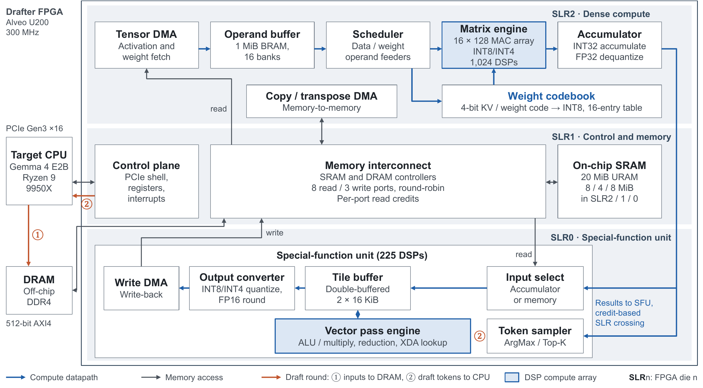

# T-Accelerator: Transformer Integrated Accelerator

> [!NOTE]
> Heterogeneous LLM-inference accelerator on the AMD Alveo U200. This page summarizes the architecture, the 300 MHz signoff and the on-board results. Status date: 2026-10-27 (image r55).

**Platform**: AMD Alveo U200 (`xcu200-fsgd2104-2-e`), `DATA_CLK` 300.00 MHz, Vivado/Vitis 2024.2, XRT 2.19.194.

---

## 1. Summary

| Metric | Value | Basis |
|---|---|---|
| Timing, current image **r55** | WNS **+0.017 ns**, WHS +0.004 ns, 0 failing endpoints | Post-route, 2026-10-27 |
| Compute | **1,024 DSP48E2** TPU (PM16 × TC128) | RTL |
| On-chip memory | 20 MiB URAM AXI SRAM + 1 MiB BRAM TUBUF | Fixed in all images |
| SRAM bandwidth | 19.2 GB/s simplex, 38.4 GB/s duplex (512-bit @ 300 MHz) | Generated-IP simulation |
| DDR bandwidth | 19.2 GB/s bus peak, **16.8 GB/s** measured (single DDR4 bank) | `xrt-smi validate -r mem-bw` |
| Qwen3-4B DFlash (r55, short8) | **45.5 tok/s** (draft 18.7 ms/round, +5.4 % over r54) | Board gate `GATE_PASS`, tokens equal Target greedy |
| Qwen3-4B cflash (r55, short8) | **47.4 – 47.8 tok/s** (draft 12.6 ms/round, +4.5 – +5.2 % over r54) | Same gate |
| Power | 50.28 W, 51.2 °C junction | Vivado **estimate**, not a board sensor reading |

Host: AMD Ryzen 9 9950X runs the Target model (`llama.cpp`, Q8_0). The U200 runs the drafter.

---

## 2. Architecture

LLM decode is memory-bound. T-Accelerator keeps KV cache and activations on chip. One shared datapath serves dense and attention ops. There is no bypass.

```
Host MMIO → TDMC → TUBUF → TOSC → TPU → TACC → SFUC → MIC-SP → SRAM | DDR
```

<p align="center">
  
  <br><em>Figure 1. Top-level block diagram across the three SLRs (<a href="fig/top.pdf">PDF</a>)</em>
</p>

<p align="center">
  
  <br><em>Figure 2. Top-level subsystem schematic</em>
</p>

| Block | SLR | Role |
|---|---|---|
| **TDMC / ILDMC** | 2 | Host-driven data movement into TUBUF. ILDMC copies memory to memory. |
| **TUBUF** | 2 | 1 MiB BRAM, 16 banks. Read T5, write T2. |
| **TOSC** | 2 | Sequences activation (DF) and weight (WF) vectors with credit-based dispatch. |
| **TPU** | 2 | PM16 × TC128 parallel tree. 1,024 DSP48E2, LUTRAM stationary weights (SINT4 → INT8), 16 CSA trees. |
| **TACC** | 2 | 16-lane INT32 saturating accumulator. GPTQ scales and FP32 FMA with RNE. 64-slot FSUM store (r55). |
| **RSPU** | 2 | FP16 transpose for attention V. |
| **SFUC** | 0 | XDA-LUT SiLU/GELU/Softmax, RMSNorm, stream ArgMax/TopK (32 × 44-bit min-heap). 225 DSP48E2. |
| **MIC-SP** | 1 | Two controllers: SRAM (`u_mic_sp`, 10-cycle read, 8R/2W credit arbiter) and DDR (`u_mic_sp_dram`, `m01_axi`, DDR[1], 256 outstanding). |
| **Command sequencer** | 0 | Dual-stream sequencer in `ct_master` with host-memory fetch. Replaces per-launch MMIO. |

Blocks cross SLR boundaries through registered credit crossings.

---

## 3. Physical Implementation

Timing closes at 300 MHz with `Congestion_SSI_SpreadLogic_high` and locality-aware pblocks: SFUC and the shell in SLR0, MIC-SP in SLR1, the compute core in SLR2. The 20 MiB URAM spans all three SLRs.

<p align="center">
  
  <br><em>Figure 3. Pblock partitioning</em>
</p>

### Timing (r55, post-route physopt)

| WNS | TNS | WHS | THS | Failing endpoints |
|---:|---:|---:|---:|---:|
| +0.017 ns | 0.000 ns | +0.004 ns | 0.000 ns | 0 of 2,093,782 |

The r55 build has total SLL use of 15,065 (SLR2↔SLR1 52.8 %, SLR1↔SLR0 34.4 %).

### Utilization (latest report in hand: r25)

| Resource | Full chip | Kernel only |
|---|---:|---:|
| CLB LUTs | 498,988 (42.21 %) | 306,582 |
| CLB FFs | 642,008 (27.15 %) | 372,621 |
| URAM | 660 (68.75 %) | 640 |
| BRAM tiles | 903.5 (41.83 %) | 635.5 |
| DSP48E2 | 1,331 (19.46 %) | 1,321 |

Main kernel consumers (LUT / DSP): SFUC 140,853 / 225, TPU 37,347 / 1,024, MIC-SP DRAM 29,513 / 0, MIC-SP SRAM 27,024 / 0, TACC 23,707 / 64. The r55 full-chip utilization report is not in this repository.

---

## 4. On-Board Results

<p align="center">
  
  <br><em>Figure 4. Interactive chat demo (<code>run_gemma.sh chat</code>). Illustration only. It is not a performance claim.</em>
</p>

- **Drafters on the U200** (the Host CPU verifies, Qwen3-4B Target):

| Drafter | Run shape | r55 board result (short8) |
|---|---|---|
| **DFlash** (z-lab, block 16 QAT) | Block draft, rows 1–15 are candidates | 45.5 tok/s; draft 18.7 ms/round; ORACLE_OK on 153 rounds |
| **cflash** variant C | Reads Target K/V (layers 1/12/22/33) | 47.4 – 47.8 tok/s; draft 12.6 ms/round; ORACLE_OK on 166 rounds |

- **DFlash and cflash at r55** share one config: SFUC chain c1, G1 INT8 hold, F3 norm fold, H1 SFUC source in SRAM, L1 CDA early producer, landing overlap `all`, D4, C2 softmax reduce RF, C4 FWHT `i3`, GLU hide, session spin 200 ms and **two command streams**. DFlash also runs O1 context pre-run, prompt pre-run and D1 layer-0 table.
- **Bottleneck**: the Host verify takes about two thirds of a round. Draft and verify run in series. The CPU idles during draft. The U200 idles during verify.
- r55 programs run only on the r55 image. The runner checks the image fingerprint.
- **Numerics (r25)**: `cda` 20/20, `lm16` 66/66, `lm32`/`lm32high` 130/130 bit-exact against oracle models. A 64 MiB DRAM round trip matches by SHA-256.
- hw_emu is functionally exact. It is not cycle-faithful for DDR traffic.

---

## 5. Host ABI

PCIe MMIO reads cost ~1,000 ns and writes ~47 ns. The Host ABI avoids both:

1. **Consumer-first launch**: arm the receiving engine, W1C the previous done, launch, wait for the terminal.
2. **D0/D1 descriptors**: each engine has two descriptor banks. A write lands on the next launch of its bank.
3. **Write elision**: the Host writes only registers that differ from the previous launch (3.3× less MMIO latency).
4. **Command ring**: the sequencer reads command streams from host memory. This is the default in the shipped run configs.

---

## 6. Reproducibility

- Toolchain: Vivado/Vitis 2024.2, XRT 2.19.194, Ubuntu 24.04.
- Core RTL is released with IEEE 1735 encryption for double-blind review. Simulation, synthesis, implementation and bitstream generation run in Vivado.
